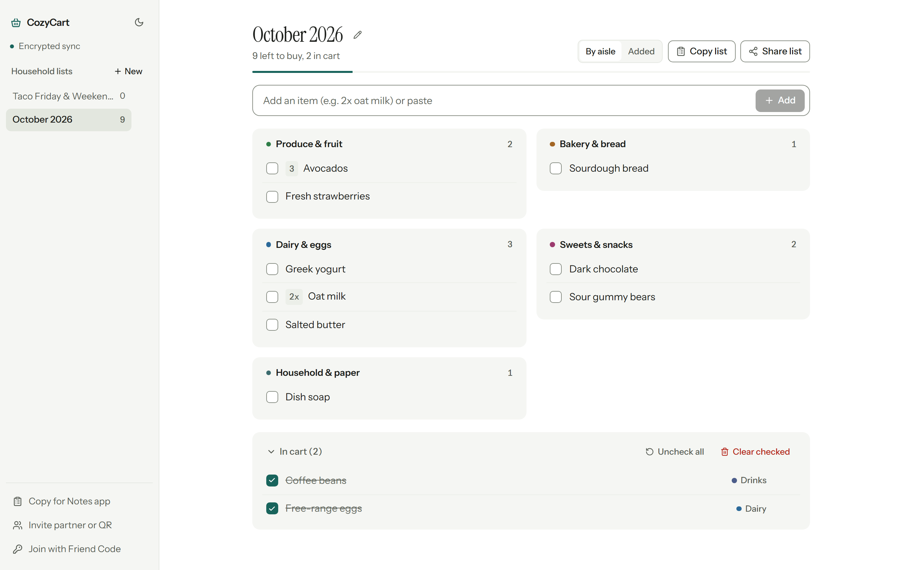

# CozyCart

Shared household shopping lists with client-side end-to-end encryption and local multilingual aisle sorting.

**[Open live app](https://dorrachai.github.io/cozy-cart/)**

<picture>
  <source media="(prefers-color-scheme: dark)" srcset="./docs/preview-dark.png">
  <source media="(prefers-color-scheme: light)" srcset="./docs/preview-light.png">
  
</picture>

## Overview

Most shared grocery apps require every member of a household to register an account, run third-party analytics SDKs, or store plaintext shopping habits on a central server.

CozyCart is a static web client built with React 19, TypeScript, Vite, and Tailwind CSS v4. Lists are encrypted in the browser via the Web Crypto API before sync, organized automatically into supermarket aisles on-device, and shared across phones and desktops using human-readable capability codes instead of user accounts.

## Capabilities

- **Two-tier capability codes**: A Household Code (`H-...`) syncs all household lists across partners or roommates. A Single-List Code (`L-...`) shares one specific list (such as a dinner party or weekend trip) without exposing the rest of the household workspace.
- **On-device multilingual aisle sorting**: Items are categorized locally against a distilled `14.6 KB` Open Food Facts taxonomy (`2,563` terms across 9 languages), compound-word suffix rules, and Fuse.js fuzzy matching, with zero external API requests. Moving an item teaches the household's encrypted dictionary for future lists.
- **Plain-text Notes interoperability**: Lists export in one click as Unicode checkboxes, clean Apple Notes / Google Keep lines, or Markdown (`- [ ]`), and multi-line checklists pasted from a phone's Notes app are parsed (`2x`, `500g`, checked states) and sorted automatically.
- **Responsive desktop & mobile workspace**: Persistent rail and two-column aisle board on desktop; thumb-anchored quick-add bar and list switcher sheet on mobile, supporting system and manual light/dark themes.

## Architecture & Security

### Zero-knowledge key derivation
Friend Codes (`47` bits of entropy: two dictionary words plus 7 unambiguous Base32 characters) pass through `PBKDF2-HMAC-SHA256` (`210,000` iterations) in the browser to derive `512` bits of key material:
- **Bytes `0..31`** are hashed with `SHA-256` to form a `64`-character hex Firestore document ID.
- **Bytes `32..63`** are imported as a non-extractable `256`-bit `AES-GCM` key.

Invite URLs and QR codes place the capability code strictly inside the URL fragment (`#join=...`), which browsers never transmit in HTTP requests to GitHub Pages or upstream proxies. Firestore stores only `{ ct, iv, rev, updatedAt }` ciphertext envelopes.

### Conflict-free concurrent sync
Each list is stored as a single encrypted envelope to keep read/write volume minimal. Concurrent item additions, check-offs, and list renames are merged client-side inside an optimistic Firestore transaction (`rev + 1`) using a deterministic Last-Write-Wins Element-Set (`LWW-Element-Set`) CRDT with `30`-day soft-delete tombstones ([`src/lib/crdt.ts`](./src/lib/crdt.ts)). Server-side [`firestore.rules`](./firestore.rules) block collection enumeration (`allow list: if false`) and enforce monotonic revision increments.

### Untrusted input & QR hardening
QR and `#join=` invites validate against a strict `[A-Za-z0-9-]` grammar and pin generated invite links to the application's own HTTP(S) origin ([`src/lib/crypto.ts`](./src/lib/crypto.ts)). Decrypted payloads pass through schema validation, control-character stripping, capability-code pinning, and CRDT timestamp clamping ([`src/lib/sanitize.ts`](./src/lib/sanitize.ts)) under a strict `script-src 'self'` Content-Security-Policy.

## Local Development

```bash
npm install
npm run dev              # Start local Vite dev server
npm test -- --run        # Run Vitest suite (crypto, sanitize, CRDT, categorizer, checklist)
npm run taxonomy:verify  # Verify distilled Open Food Facts taxonomy integrity & gzip budget
npm run build            # Type-check and build static production bundle into dist/
```

When run without environment variables, CozyCart operates locally using `localStorage` and `BroadcastChannel`, allowing multi-tab sync testing with zero cloud setup.

To connect cross-device cloud sync via Firebase (Spark free tier):
1. Copy [`.env.example`](./.env.example) to `.env.local` and fill in your Firebase Web App config values.
2. Enable **Anonymous Authentication** and **Cloud Firestore** in your Firebase project, then deploy [`firestore.rules`](./firestore.rules).
3. Restrict your browser API key's HTTP referrers in Google Cloud Console to your deployed domain.

## License

[MIT](./LICENSE)
